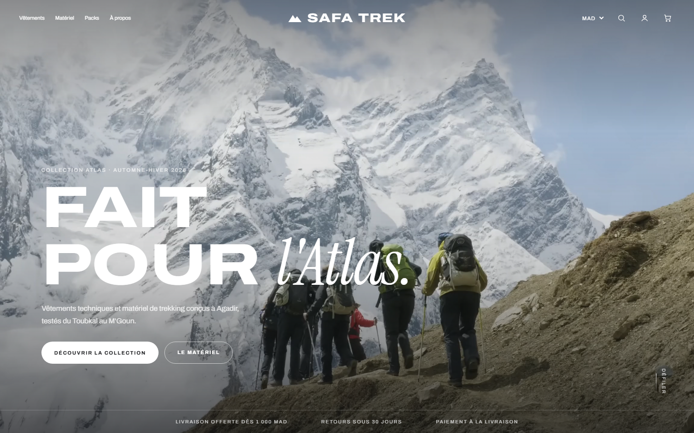
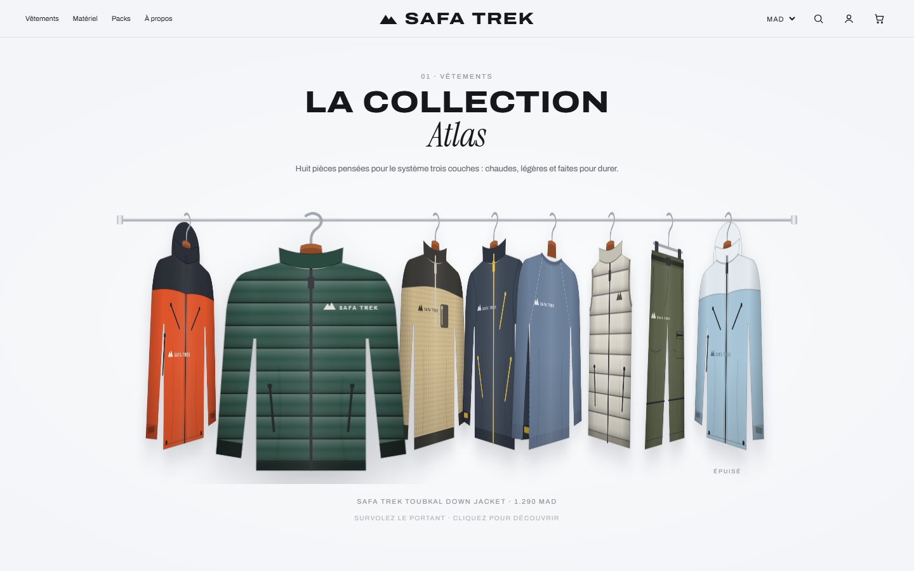
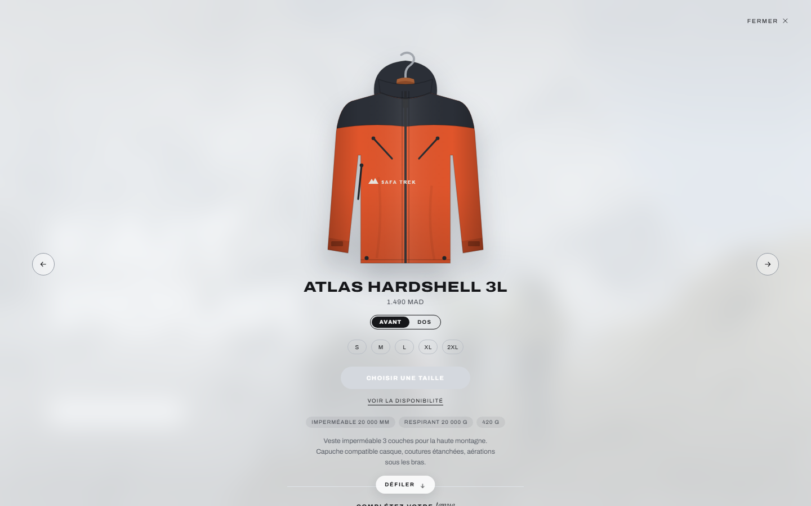
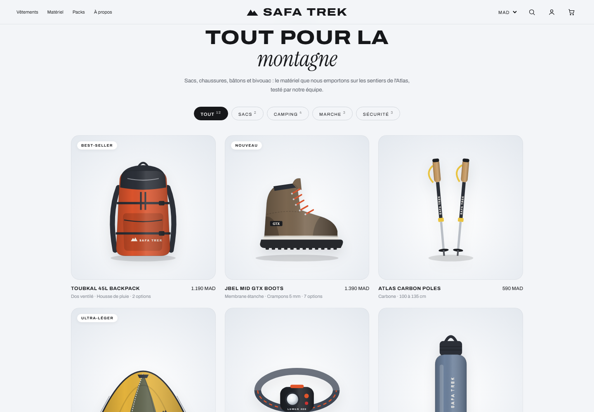
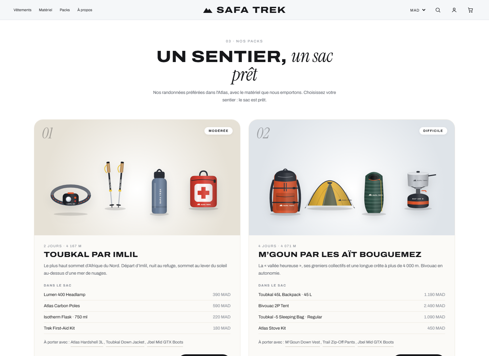
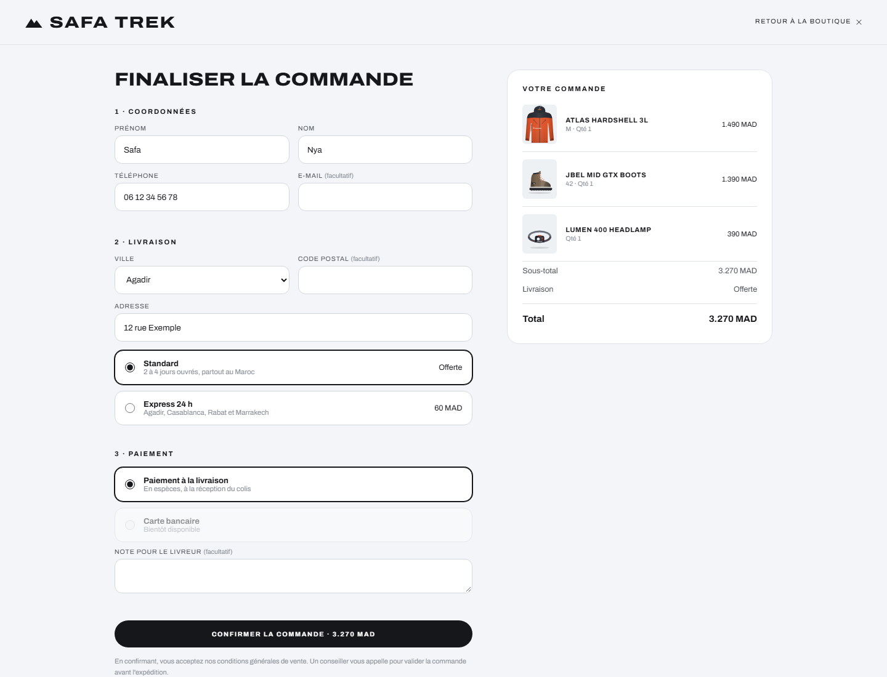

# Safa Trek

Boutique en ligne de **vêtements et matériel de trekking**, pensée pour les randonnées dans l'Atlas marocain.
Site vitrine e-commerce au design éditorial : portant de vêtements interactif, fiches produit, packs par randonnée, panier et commande avec paiement à la livraison.



## Aperçu

| Le portant de vêtements | La fiche produit |
|---|---|
|  |  |

| Le matériel | Les packs par randonnée |
|---|---|
|  |  |



## Fonctionnalités

- **Hero vidéo plein écran** avec un décor de montagnes animé en attendant le chargement de la vidéo.
- **Portant interactif** : vêtements répartis sur trois portants (hauts Atlas, pantalons, collection Rose pour femme), tournés de côté ; au survol, la pièce pivote de face et grandit.
- **Fiche produit** sur fond givré : vue avant / dos animée, tailles avec stock, caractéristiques techniques et suggestions « Complétez votre tenue ».
- **Matériel** : 23 produits (sacs, chaussures, tente, réchaud, lampe frontale…) avec filtres par catégorie, dont une collection **Tête & souffle** : casquette, bonnet, tour de cou, masque air froid et bandelettes nasales, ainsi que des chaussures essayables sur le mannequin.
- **Cabine d'essayage** : un mannequin porte les vêtements et accessoires choisis (haut, pantalon, couvre-chef, lunettes, masque…).
- **Système trois couches** : un guide qui relie chaque couche au produit conseillé.
- **Packs par randonnée** : Toubkal, M'Goun, gorges du Todra et Paradise Valley, avec le matériel à emporter et un bouton « Ajouter le sac ».
- **Panier** enregistré dans le navigateur, quantités et sous-total.
- **Commande** : coordonnées, ville, livraison standard ou express, paiement à la livraison, validation du numéro marocain. Chaque commande est envoyée par e-mail au vendeur.
- **Historique « Mes commandes »**, recherche, prix en MAD ou en EUR, site adapté au mobile.

## Technologies

- HTML, CSS et JavaScript, sans framework ni étape de build.
- Vêtements et matériel **dessinés en SVG** directement dans le code ; une photo `images/<id>.png` les remplace automatiquement si elle existe.
- Envoi des commandes par e-mail avec [FormSubmit](https://formsubmit.co).
- Polices Google Fonts : Archivo et Instrument Serif.

## Lancer le projet

```bash
npm run dev
```

Le site s'ouvre sur http://localhost:8100. On peut aussi ouvrir `index.html` directement dans le navigateur.

## Structure

```
safa-trek/
├── index.html     le site complet (HTML, CSS et JavaScript)
├── images/        photos produit facultatives (voir images/LISEZMOI.md)
├── videos/        vidéo du hero (voir videos/LISEZMOI.md)
└── docs/          captures d'écran de ce README
```

## Crédits

- Vidéo du hero : « Nepal, Himalayas, Trekking » par TungArt7, [Pixabay](https://pixabay.com/videos/nepal-himalayas-trekking-mountain-258658/) (licence Pixabay).
- Safa Trek est une marque fictive : ce site est un projet de démonstration.

## Auteure

**Safa Nya**, ingénieure logiciel et Data Analyst.
[LinkedIn](https://www.linkedin.com/in/safa-nya-aa5633266/)
